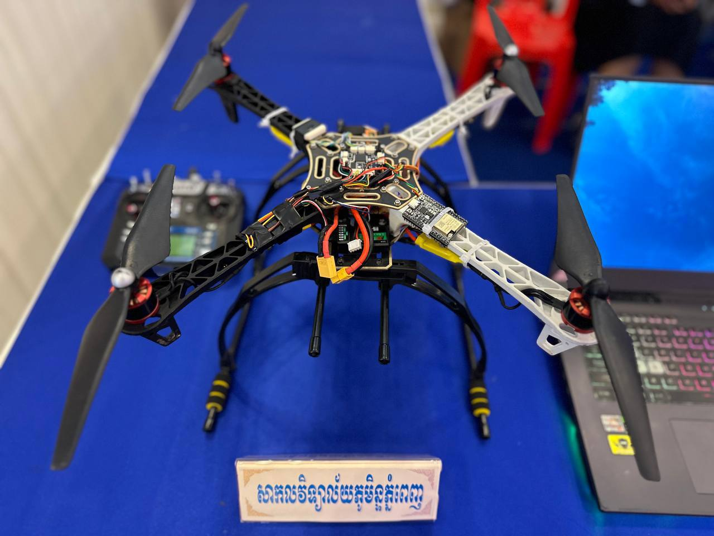

# Autonomous & Manual Delivery Drone (ArduPilot & MicoAir F405)

## Project Overview
This project focuses on the design, configuration, and deployment of a delivery drone capable of operating in both manual pilot-controlled modes and fully autonomous waypoint navigation. Powered by the **MicoAir F405** flight controller running **ArduPilot** firmware, tailored specifically for precise cargo delivery missions.

---

## Hardware & Architecture
- **Flight Controller:** MicoAir F405 (STM32F405 MCU)
- **Firmware:** ArduPilot Copter
- **Ground Control Station:** Mission Planner
- **Payload:** Electronic cargo release mechanism for delivery missions.

---

## Lab Proof of Concept & Demonstration

### 1. Delivery Drone Hardware Setup

### 2. Flight & Delivery Operation Video
Watch the drone performing its flight and delivery operations:
> [View Drone Video Demo](Drone-vdo.MOV)
